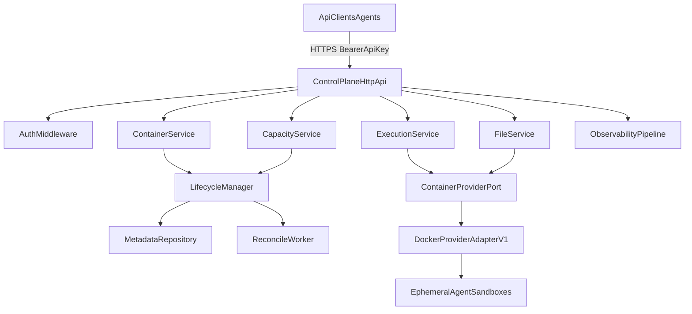
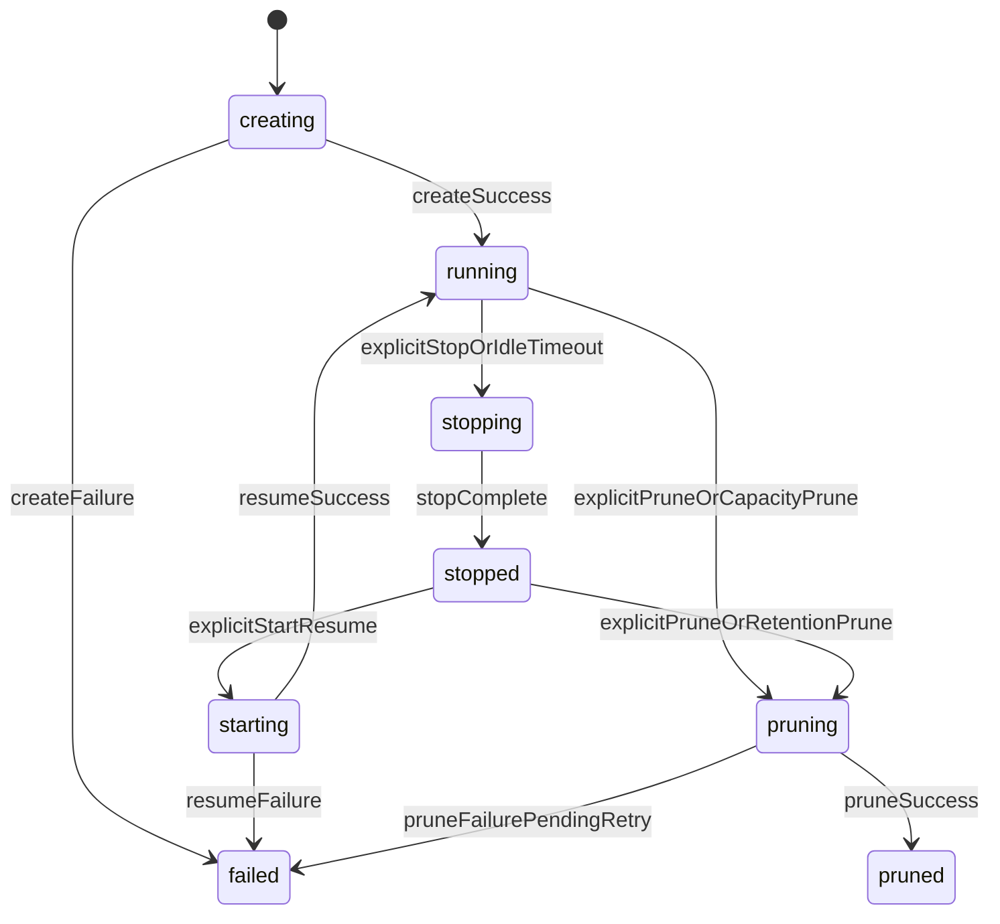
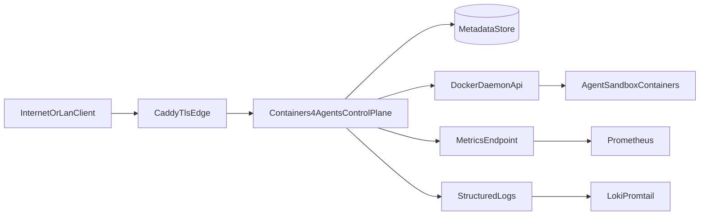

# containers4agents v1 High-Level Architecture

## 1) Context and Goals

`containers4agents` provides a provider-agnostic container runtime service for agent tool execution. The v1 objective is to expose a stable HTTP control-plane API for:

- ephemeral container lifecycle operations
- bounded command execution
- workspace-scoped file operations

This architecture is derived from `REQUIREMENTS.md` and intentionally keeps Docker as an implementation detail behind a provider interface.

### v1 goals

- Keep the public API stable while allowing provider swaps later.
- Enforce strict sandbox isolation: no outbound/inbound network from agent containers, bounded resources, and no privileged execution.
- Preserve resumable stopped containers and explicit permanent prune semantics.
- Provide metadata-only observability, structured errors, and request correlation.
- Support Docker-first deployment in the existing Portainer-managed lab environment.

### v1 non-goals

- No model-provider-specific orchestration logic.
- No multi-tenant identity model beyond a single service API key.
- No durable backup/restore beyond container lifecycle.
- No GPU, runtime package installation, or long-running daemon contract in sandboxes.

## 2) System Boundaries

The architecture has two strict boundaries:

1. **Client-facing control plane API**
   - Authenticates requests.
   - Manages container lifecycle state.
   - Executes commands with bounded outcomes.
   - Manages files inside workspace root.
   - Returns provider-agnostic statuses and errors.

2. **Internal provider interface**
   - Provisions, starts, stops, prunes, and executes against sandbox runtimes.
   - Performs file transfers and metadata reads from outside the sandbox network.
   - Normalizes provider-specific errors into control-plane semantics.

### Boundary rules

- Public API must not leak Docker-specific identifiers, network names, mount paths, or daemon error contracts.
- Provider internals must be replaceable (Docker now, stronger isolation runtimes later) without API shape changes.
- Lifecycle authority lives in the control plane, not in client assumptions about runtime internals.

## 3) Logical Components

### Component topology



### Component responsibilities

- `ControlPlaneHttpApi`
  - Route/version handling (`/v1`), request validation, request IDs, structured responses.
- `AuthMiddleware`
  - Bearer key verification (`CONTAINERS4AGENTS_API_KEY`), constant-time compare, `401` behavior.
- `ContainerService`
  - Create, status, start/resume, stop, prune orchestration.
- `LifecycleManager`
  - State transitions, idle-stop and retention-prune scheduling, activity timestamp updates, conflict checks.
- `ExecutionService`
  - Bounded command execution, output truncation, status mapping (`ok`, `timeout`, `oom`, etc.).
- `FileService`
  - Workspace-root path validation, upload/download/delete/manifest, hashing and usage accounting.
- `CapacityService`
  - Admission control and reclamation policy before rejecting new work.
- `MetadataRepository`
  - Source of truth for container state, timers, image/profile metadata, and reconciliation records.
  - Implemented through Ent-backed persistence adapters over PostgreSQL.
- `ReconcileWorker`
  - Startup consistency pass and retry loop for failed deletions.
- `ContainerProviderPort`
  - Provider-independent runtime contract.
- `DockerProviderAdapterV1`
  - Hardened Docker implementation of the provider contract.
- `ObservabilityPipeline`
  - Logs and metrics emission with metadata-only constraints.

### Provider port contract (high-level)

```text
type ContainerProvider interface {
  CreateSandbox(ctx, spec) -> ProviderContainer
  StartSandbox(ctx, providerContainerId)
  StopSandbox(ctx, providerContainerId)
  PruneSandbox(ctx, providerContainerId)
  Exec(ctx, providerContainerId, execRequest) -> ExecResult
  UploadFile(ctx, providerContainerId, path, content)
  DownloadFile(ctx, providerContainerId, path) -> bytes
  DeletePath(ctx, providerContainerId, path)
  ListWorkspace(ctx, providerContainerId) -> []FileEntry
  ReadUsage(ctx, providerContainerId) -> UsageSnapshot
}
```

## 4) Core Flows

### 4.1 Create container

1. API authenticates request and validates profile/image policy.
2. `CapacityService` checks available capacity and performs reclamation when needed.
3. `ContainerService` allocates new container identity and writes `creating` metadata.
4. `DockerProviderAdapterV1` provisions sandbox.
5. On success: metadata transitions to `running` and response returns container identity + profile/image metadata.
6. On failure: metadata transitions to `failed` with normalized error.

### 4.2 Execute command

1. API validates container state and execution payload.
2. `ExecutionService` confirms allowable state and applies execution limits.
3. Provider executes command with wall-clock, resource, and output caps.
4. Output is captured and truncated as configured.
5. Response returns execution status taxonomy and duration/resource summary.
6. Activity timestamps update without extending lifecycle via passive polling.

Execute command semantics:

- Execution requests use structured argv payloads (`command: []string`) rather than free-form shell strings.
- Timeout is enforced by server policy/configuration for predictable control-plane behavior.
- Only one in-flight execution per container is permitted; concurrent requests return conflict.
- The in-flight execution lease is persisted in metadata so the single-exec invariant is enforced across multiple API replicas.
- Exec against non-running containers does not implicitly resume the container.

### 4.3 File operations

1. API validates root-relative path constraints.
2. `FileService` rejects traversal and paths outside workspace root.
3. Provider performs file I/O from outside sandbox networking.
4. Manifest responses include root-relative path, type, size, mtime, and SHA-256.
5. Disk usage metadata is refreshed for status visibility.

File operation semantics:

- API contract uses raw bytes for direct file transfer:
  - `PUT /v1/containers/{id}/files/{path...}` for upload
  - `GET /v1/containers/{id}/files/{path...}` for download
  - `DELETE /v1/containers/{id}/files/{path...}` for delete
  - `GET /v1/containers/{id}/files/manifest` for flat manifest + usage snapshot
- File operations are allowed only for `running` and `stopped` containers.
- `pruned`, `failed`, and transition states return structured conflict responses.
- Provider implementations must reject symlink/path resolution that escapes `/workspace`.

### 4.4 Stop, resume, and prune

1. Stop transitions `running -> stopping -> stopped`; workspace remains available for resume.
2. Resume transitions `stopped -> starting -> running` using existing workspace.
3. Prune transitions to `pruning`, hard deletes runtime/workspace state, then marks `pruned`.
4. Reconciliation retries failed prune operations until completed.

### 4.5 Startup reconciliation

1. On process start, control plane loads metadata records with non-terminal lifecycle states.
2. Provider state is queried for each candidate container.
3. Drift is resolved into canonical states (`failed`, `stopped`, `pruned`, etc.).
4. Pending timer and deletion work queues are rebuilt from metadata.

## 5) State and Lifecycle Model

Canonical lifecycle states:

- `creating`
- `running`
- `stopping`
- `stopped`
- `starting`
- `pruning`
- `pruned`
- `failed`

### Lifecycle transitions



### Lifecycle invariants

- A stopped container is resumable until pruned.
- A pruned container is unrecoverable under the same identity.
- Polling/status checks must not be treated as activity for idle timeout extension.
- Exec/file operations in invalid states return conflict errors instead of implicit state mutation.

## 6) Security and Isolation Model

### API security

- Single bearer API key in v1.
- API key sourced from `CONTAINERS4AGENTS_API_KEY` or generated once at startup.
- TLS required across untrusted networks (terminated at Caddy or service edge).

### Sandbox isolation

- Non-root execution identity.
- No privileged mode, no host device access, no runtime socket in sandbox.
- Read-only root filesystem when feasible; writable workspace root only.
- Capability minimization with strict syscall policy.
- Per-container process and resource ceilings.
- Runtime hardening controls are sourced from the active resource policy profile and mapped into provider create/exec behavior.

### Network policy

- No inbound/outbound network for agent containers.
- No dependency on sandbox network reachability for exec/file functionality.
- Provider performs management operations externally.

### Data protection and logging

- No command text, stdout/stderr, file contents, or auth headers in logs.
- Keep path and metadata logging minimal and operationally justified.
- Return provider errors only after sanitization.

## 7) Deployment Architecture (Docker + Portainer Lab)

v1 deployment target is Docker managed by Portainer, aligned with existing lab stack patterns.

### Lab deployment topology



### Deployment shape

- Service runs as a single stateless Go API container.
- Service joins internal lab network (for example `edge_net`) and is fronted by Caddy for TLS and routing.
- Service needs controlled access to Docker daemon API for provider operations.
- Metadata store runs as PostgreSQL in a separate service/container with persistent volume.
- Metrics endpoint is scraped by Prometheus; logs flow to Loki via existing logging pipeline.

### Portainer and stack conventions

- Define `containers4agents` as its own Portainer-managed compose stack.
- Use immutable image tags for controlled rollout (plus `latest` in lab if needed).
- Use `restart: unless-stopped`.
- Keep service internal-only by default; expose public endpoint only via explicit Caddy route policy.

### Minimal runtime configuration set

- `CONTAINERS4AGENTS_API_KEY`
- `C4A_HTTP_LISTEN_ADDR` (for example `:8080`)
- `C4A_LOG_LEVEL`
- `C4A_PROVIDER=docker`
- `C4A_DOCKER_ENDPOINT`
- `C4A_METADATA_DSN`
- `C4A_IDLE_TIMEOUT`
- `C4A_STOPPED_RETENTION`
- `C4A_DEFAULT_PROFILE=prod-strict`
- `C4A_ACTIVE_IMAGE_VERSION`
- `C4A_RESOURCE_POLICY_FILE` (optional; when unset or unreadable, compiled defaults are used)

### Resource policy loading semantics

- Complex limit/isolation policy is loaded from a file path provided by `C4A_RESOURCE_POLICY_FILE`.
- If the path is unset, or the file is unreadable, startup uses compiled `prod-strict` defaults.
- If the file is readable but invalid, startup fails fast.
- Capacity invariants are validated at load time (`active_exec_limit <= running_container_limit <= total_container_limit`).

## 8) Reliability and Operations

### Reliability patterns

- Persist lifecycle state in metadata store; never rely only on in-memory timers.
- Startup reconciliation is mandatory after process restart.
- Deletion failures enter retry queue with bounded backoff and observability.
- Lifecycle and execution operations support safe retries and idempotent behavior where required.

### API behavior requirements

- Structured error payloads include machine code, message, request ID, and retryability.
- Command-level failures return 2xx with structured execution status.
- Invalid transitions return conflict-class errors.

### Observability baseline

- Request metrics: latency, status classes, auth failures.
- Lifecycle metrics: creates, starts, stops, prunes, reconciliation corrections.
- Execution metrics: durations, timeout/oom/quota outcomes.
- Capacity metrics: reclamation counts and admission rejects.

## 9) Persistence Model (PostgreSQL + Ent)

v1 metadata persistence standard is PostgreSQL accessed through Ent ORM.

### Why Ent for this service

- Typed schema and query APIs reduce lifecycle-state drift bugs in control-plane logic.
- Centralized migration flow supports predictable rollout in Docker/Portainer environments.
- Matches proven patterns already used in `chat-app` (`ent/schema`, startup migrations, and datastore abstractions).

### Ent implementation pattern (modeled after chat-app)

- Keep Ent schemas in `ent/schema/`.
- Keep generated Ent code in `ent/` and never hand-edit generated artifacts.
- Run schema migrations from service startup behind explicit environment guards (for example `AUTO_MIGRATE`).
- Keep business logic in metadata repository/service layers; handlers should not directly perform schema-level operations.
- Use index and constraint definitions in Ent schemas for lifecycle query paths and state-transition safety.

## 10) Initial Go Project Layout

The v1 codebase should follow a simple single-binary structure (like `auth-gate`) while pre-splitting domain packages to avoid a monolithic server package.

```text
containers4agents/
  cmd/
    containers4agents/
      main.go
  ent/
    schema/
      time_mixin.go
      container_metadata.go
      execution_record.go
      file_manifest_entry.go
  internal/
    config/
    server/
    auth/
    api/
      handlers/
      middleware/
      errors/
    lifecycle/
    execution/
    files/
    capacity/
    provider/
      docker/
      types/
    metadata/
      repository/
      migrations/
      entrepo/
    reconcile/
    observability/
      metrics/
      logging/
  deployments/
    docker/
      compose.yml
  docs/
    ADR_BACKLOG.md
```

### Package design guidance

- Keep API layer and provider adapter separated by interfaces in `internal/provider/types`.
- Keep state transition logic centralized in `internal/lifecycle` to avoid hidden mutations.
- Keep path safety and workspace constraints centralized in `internal/files`.
- Keep reconciler independent so it can run at startup and periodic intervals with the same code path.
- Keep Ent schema/model concerns in `ent/` and isolate query orchestration behind `internal/metadata/repository`.

## 11) Open Decisions and ADR Queue

Shortlist of ADR candidates for v1 (detailed in `docs/ADR_BACKLOG.md`):

1. Metadata schema shape and migration strategy details (PostgreSQL + Ent selected).
2. Container ID generation model (service-generated vs caller-supplied).
3. Idempotency key contract for create/stop/start/prune/upload.
4. Execution concurrency policy per container.
5. Auto-resume behavior when exec is requested against stopped containers.
6. Concrete `prod-strict` defaults for CPU/memory/disk/timeouts/output caps.
7. Docker access model in Portainer stack (socket mount vs remote endpoint with TLS).

Each decision should capture:

- selected default for v1
- rationale and requirement mapping
- migration path if changed in v2

## 12) Reference patterns from existing projects

The following existing repo patterns directly influenced this architecture:

- `auth-gate`
  - single binary with `cmd/` + `internal/` organization
  - env-first configuration and structured JSON logs
  - distroless Docker build and Portainer-compatible compose stack conventions
- `chat-app` API server
  - explicit internal domain package boundaries for scale (`handlers`, `middleware`, service/data layers)
  - startup/shutdown lifecycle discipline and richer operational wiring
  - separation of transport layer concerns from domain and persistence concerns
  - Ent schema organization and startup migration flow for Postgres-backed state
